<div align="center">

<!-- ══════════════════════════════════════════════════════════════════ -->
<!--           ⚡ CYBERPUNK HUD ANIMATED SVG HEADER                   -->
<!-- ══════════════════════════════════════════════════════════════════ -->

<a href="https://abdulmoizans.netlify.app/" target="_blank">
  
</a>

<br/><br/>

<!-- Fast-Access Command Deck -->
<p align="center">
  <a href="https://abdulmoizans.netlify.app/" target="_blank">
    
  </a>
  &nbsp;
  <a href="https://www.linkedin.com/in/abdul-moiz-ansari-91a132234" target="_blank">
    
  </a>
  &nbsp;
  <a href="mailto:support@edusaas.site">
    
  </a>
</p>

<!-- Telemetry Diagnostics Strip -->
<p align="center">
  
  &nbsp;
  
  &nbsp;
  
  &nbsp;
  
</p>

</div>

---

### 📡 OPERATOR TELEMETRY // HUD TERMINAL

```
┌──[ ABDUL MOIZ ANSARI @ QUANTUM-OS ]─────────────────────────────────────────[ v2.6.0 ]──┐
│                                                                                         │
│  $ whoami --verbose                                                                     │
│  > OPERATOR     : Abdul Moiz Ansari                                                     │
│  > DISCIPLINE   : Autonomous Systems & Software Architect • Low-Level Windows Engineer  │
│  > CLEARANCE    : Level-3 Network Security • Offline-First Mesh • High-Throughput POS   │
│  > STATUS       : ONLINE // Available for High-Impact Remote Contracts & Tech Roles    │
│  > BASE         : Pakistan 🇵🇰 (Deployable Globally // Remote-First Autonomy)           │
│                                                                                         │
│  $ cat /proc/system_capabilities                                                        │
│  ├── [KERNEL]     : Win32 API • Wintun Driver • Layer-3 Full-System TUN Routing         │
│  ├── [COMPILER]   : Python 3.12 compiled to Standalone Native C via MinGW-w64 / Nuitka  │
│  ├── [PLATFORMS]  : Next.js 15 (Server Actions) • React 19 • FastAPI • Hono Edge Runtime│
│  ├── [SECURITY]   : RSA-2048 Asymmetric Signatures • Windows DPAPI • Cloudflare DoH    │
│  └── [PERSISTENCE]: PostgreSQL • SQLite (WAL Concurrency) • Turso LibSQL • Prisma ORM  │
│                                                                                         │
│  $ system --benchmark-summary                                                           │
│  [✓] XION VPN Workstation   : 0% IP/DNS Leak Verified via 2ip.io Audit                  │
│  [✓] NIZAAM POS Pipeline    : < 500ms End-to-End Checkout Pipeline (0.2s Barcode)       │
│  [✓] EduSaaS Offline ERP    : < 1.2s Cold Start • 136 Validated REST Endpoints          │
│  [✓] AI Typing Context      : 69/69 Automated Test Suites Passing (100% Zero-Trust)     │
│                                                                                         │
└─────────────────────────────────────────────────────────────────────────────────────────┘
```

---

## 🏛️ SYSTEM TOPOLOGY // HIGH-LEVEL ARCHITECTURE

```mermaid
flowchart LR
    subgraph DesktopLayer["🖥️ LOW-LEVEL DESKTOP & SYSTEMS KERNEL"]
        direction TB
        XION["⚡ XION VPN Workstation
(Layer-3 TUN • Sing-Box • Wintun)"]
        DROX["🎨 Drox Screen Studio
(25-30 FPS BitBlt • FFmpeg Mux)"]
        TYPING["🤖 AI Typing Assistant
(N-Gram Engine • Zero-Trust Air-Gap)"]
        SHOX["⚡ SHOX System Monitor
(Taskbar Watchdog • < 0.1% CPU)"]
    end

    subgraph SecurityLayer["🛡️ CRYPTOGRAPHIC & PRIVACY SHIELD"]
        direction TB
        RSA["RSA-2048 Offline Verification"]
        DPAPI["Windows DPAPI Encrypted Vault"]
        DOH["Cloudflare DNS-over-HTTPS (1.1.1.1)"]
        NUITKA["Nuitka Native C Decompilation Guard"]
    end

    subgraph CloudOffline["☁️ DISTRIBUTED CLOUD SAAS & OFFLINE MESH"]
        direction TB
        NIZAAM["🛒 NIZAAM Cloud ERP & POS
(Next.js 15 • Turso LibSQL • 0.2s Barcode)"]
        EDUSAAS_OFF["🖥️ EduSaaS Offline ERP
(FastAPI • SQLite WAL • LAN Wi-Fi Mesh)"]
        EDUSAAS_CLOUD["🏫 EduSaaS Cloud Platform
(300+ APIs • 69 Models • WhatsApp Bot)"]
    end

    DesktopLayer <==> SecurityLayer
    SecurityLayer <==> CloudOffline
```



---

## ⚡ FEATURED WORKSTATIONS & ENGINEERING FLAGSHIPS

<br/>

### ⚡ `01 // XION VPN DESKTOP WORKSTATION`
> **Autonomous Windows Desktop VPN Workstation • Layer-3 Full-System TUN Routing • 0% DNS/IP Leak**

```
┌──────────────────────────────────────────────────────────────────────────────────────────┐
│ STACK: Python 3.12 • Sing-Box Core • CustomTkinter • Wintun Driver • Cloudflare DoH     │
├──────────────────────────────────────────────────────────────────────────────────────────┤
│ • Full-System TUN Routing: Encrypts 100% of Windows OS traffic at network Layer-3.       │
│ • Zero-Leak Guarantee: Passed 100% anonymity audit on 2ip.io (0% IP or DNS leak).       │
│ • Cyberpunk GUI: 30 FPS animated radar rings with rolling real-time traffic waveforms.   │
│ • Watchdog Kill Switch: Automated instant network freeze on unexpected tunnel drop.      │
└──────────────────────────────────────────────────────────────────────────────────────────┘
```
[](https://github.com/AbdulMoizAns/XION-VPN/releases/tag/v1.0.0)
&nbsp;
[](https://github.com/AbdulMoizAns/XION-VPN)

<br/>

### 🎨 `02 // DROX SCREEN STUDIO`
> **High-Performance Windows Screen Annotation, Interactive Drawing & Synchronized Studio Recorder**

```
┌──────────────────────────────────────────────────────────────────────────────────────────┐
│ STACK: Python 3.12 • PyQt6 • FFmpeg • Windows GDI BitBlt • SoundDevice • pynput         │
├──────────────────────────────────────────────────────────────────────────────────────────┤
│ • High-Speed GDI Capture: Steady 25–30 FPS BitBlt video capture with crisp cursor.      │
│ • Synchronized Mic Muxer: Records microphone stream simultaneously and muxes to MP4.    │
│ • Presentation Suite: Fading laser pointer trail, audience spotlight circle, and boards. │
│ • Instant Pass-Through: Tap F2 to pass mouse clicks directly to underlying PowerPoint.   │
└──────────────────────────────────────────────────────────────────────────────────────────┘
```
[](https://github.com/AbdulMoizAns/drox)
&nbsp;
[](https://github.com/AbdulMoizAns/drox)

<br/>

### 🖥️ `03 // EDUSAAS OFFLINE WINDOWS ERP`
> **Standalone Zero-Internet School Management ERP & Multi-Device Local LAN Wi-Fi Mesh**

```
┌──────────────────────────────────────────────────────────────────────────────────────────┐
│ STACK: FastAPI • SQLite (WAL Mode) • Nuitka Native C • PyWebView • ReportLab • RSA-2048  │
├──────────────────────────────────────────────────────────────────────────────────────────┤
│ • 100% Offline Autonomy: Runs on a single Windows laptop without internet connection.     │
│ • Dual-Mode LAN Mesh: Solo loopback guard vs. local Wi-Fi sharing for mobile/tablets.   │
│ • Anti-Piracy Armor: Compiled from Python to native C via Nuitka (zero bytecode).        │
│ • Vector PDF Engine: Sub-200ms ReportLab generator for 3-copy bank challans & DMCs.      │
└──────────────────────────────────────────────────────────────────────────────────────────┘
```
[](https://github.com/AbdulMoizAns/EduSaaS-Offline-Showcase)
&nbsp;
[](https://github.com/AbdulMoizAns/EduSaaS-Downloads/releases/latest/download/EduSaaS-Setup.exe)
&nbsp;
[](https://edusaas.site)

<br/>

### 🛒 `04 // NIZAAM CLOUD ERP & POINT OF SALE`
> **Cloud ERP & High-Throughput Point of Sale Ecosystem with Sub-Second Checkout Pipeline**

```
┌──────────────────────────────────────────────────────────────────────────────────────────┐
│ STACK: Next.js 15 (Server Actions) • React 19 • Turso LibSQL • Tailwind CSS • ESC/POS    │
├──────────────────────────────────────────────────────────────────────────────────────────┤
│ • Sub-500ms Register Pipeline: Microsecond barcode resolution and instant cashout.       │
│ • Magic Barcode Auto-Fill: Resolves product names and imagery in 0.2s via proxy.         │
│ • Hardware Integration: ESC/POS 58mm/80mm thermal receipt printing with verification QR. │
│ • Local Digital Rails: Integrated Raast, JazzCash, and EasyPaisa payment flows.          │
└──────────────────────────────────────────────────────────────────────────────────────────┘
```
[](https://github.com/AbdulMoizAns/Nizaam-ERP-Showcase)

<br/>

### 🏫 `05 // EDUSAAS ENTERPRISE CLOUD PLATFORM`
> **Comprehensive Multi-Tenant Institutional Operating System & Academic Infrastructure**

```
┌──────────────────────────────────────────────────────────────────────────────────────────┐
│ STACK: Node.js • Express • React • PostgreSQL • Prisma ORM • Docker • Baileys WhatsApp   │
├──────────────────────────────────────────────────────────────────────────────────────────┤
│ • 8 Isolated RBAC Roles: Super Admin, Principal, Teacher, Student, Parent, Accountant.   │
│ • Extensive API Surface: 300+ secure REST endpoints and 69 relational domain models.     │
│ • Dynamic QR Attendance: Mobile & webcam scanner eliminating attendance proxy fraud.     │
│ • WhatsApp Automation: Multi-device headless bot dispatching automated fee vouchers.    │
└──────────────────────────────────────────────────────────────────────────────────────────┘
```
[](https://github.com/AbdulMoizAns/EduSaaS-Platform-Showcase)
&nbsp;
[](https://edusaas.site)
&nbsp;
[](https://github.com/AbdulMoizAns/edusaas-mobile-releases)

<br/>

### 🤖 `06 // ALPHA AI TYPING ASSISTANT`
> **Universal Windows Typing Accelerator with Offline Air-Gapped Zero-Trust Firewall**

```
┌──────────────────────────────────────────────────────────────────────────────────────────┐
│ STACK: Python 3.12 • NLP N-Gram Context Engine • pywin32 • Caret API • Windows Firewall  │
├──────────────────────────────────────────────────────────────────────────────────────────┤
│ • Contextual Prediction: Google Gboard-style spacebar predictions powered by bigrams.    │
│ • Dual Language: Fluent phonetic correction for Roman Urdu and international English.   │
│ • Air-Gap Firewall: 100% offline isolated process ensuring zero keystroke leakage.       │
│ • Test Integrity: 69/69 automated test suites passing with 100% verification.           │
└──────────────────────────────────────────────────────────────────────────────────────────┘
```
[](https://github.com/AbdulMoizAns/typing-assistant/releases/tag/v1.0.0)
&nbsp;
[](https://github.com/AbdulMoizAns/typing-assistant)

---

## 🛠️ CORE ENGINEERING & TECHNOLOGY MATRIX

<div align="center">

### 🖥️ Low-Level Systems, Drivers & Native Runtimes
<p>
  
  
  
  
  
  
  
  
</p>

### 🔒 Cryptography, Security & Network Protocols
<p>
  
  
  
  
  
  
  
</p>

### ☁️ Enterprise Cloud SaaS, High-Throughput Web & Backends
<p>
  
  
  
  
  
  
  
  
</p>

### 🗄️ Relational Data Engines, Edge Replication & DevOps
<p>
  
  
  
  
  
  
  
</p>

</div>

---

## 📈 TELEMETRY & ACTIVITY DASHBOARD

<div align="center">

<table border="0" style="background:transparent;">
  <tr>
    <td align="center">
      
    </td>
    <td align="center">
      
    </td>
  </tr>
</table>

<br/>


<br/><br/>


<br/><br/>


</div>

---

## 🤝 DIRECT COLLABORATION CHANNELS

<div align="center">

| 🚀 **High-Impact Engagement** | 🔒 **Deep Technical Focus Areas** |
| :--- | :--- |
| ✅ **Autonomous Systems & Software Architecture** | 🛡️ **Layer-3 TUN Network Security Workstations** |
| ✅ **Enterprise Multi-Tenant Cloud ERP / SaaS** | 🖥️ **High-Performance Windows Desktop Software & Daemons** |
| ✅ **Offline-First Zero-Internet Local LAN Mesh** | ⚡ **Sub-Second POS Pipelines & Hardware Printer Drivers** |
| ✅ **Deep-Tech Cryptographic Licensing & Hardware Locks** | 🤖 **AI Assistant Utilities & Offline NLP Engines** |

<br/>

<p align="center">
  <a href="https://www.linkedin.com/in/abdul-moiz-ansari-91a132234" target="_blank">
    
  </a>
  &nbsp;&nbsp;
  <a href="https://abdulmoizans.netlify.app/" target="_blank">
    
  </a>
  &nbsp;&nbsp;
  <a href="mailto:support@edusaas.site">
    
  </a>
</p>

<br/>

<sub>© 2024–2026 Abdul Moiz Ansari — Autonomous Systems & Software Engineer. Engineered with precision.</sub>

</div>
