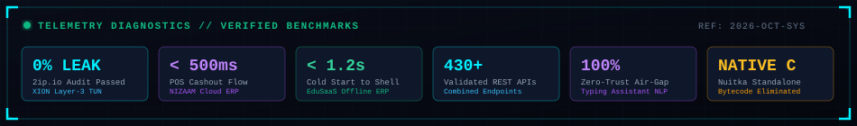
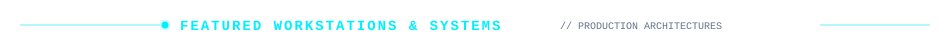
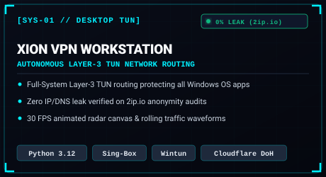
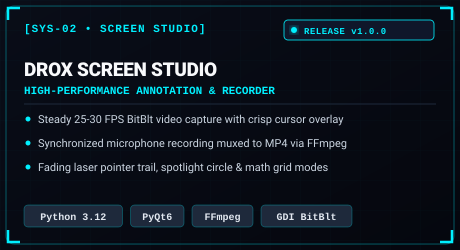
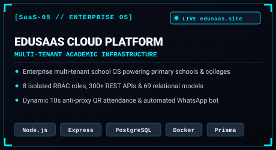
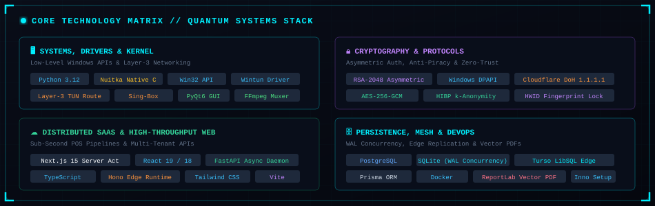
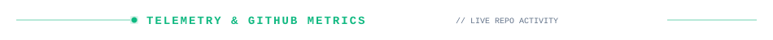
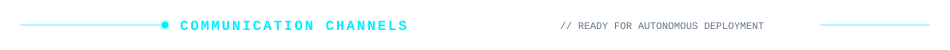

<!-- ══════════════════════════════════════════════════════════════════ -->
<!--           ⚡ CYBERPUNK HUD ANIMATED SVG HEADER                   -->
<!-- ══════════════════════════════════════════════════════════════════ -->

  

<!-- Telemetry Diagnostics & Real-Time Benchmarks -->

  

<!-- ══════════════════════════════════════════════════════════════════ -->
<!--           ⚡ FEATURED WORKSTATIONS & SYSTEMS                     -->
<!-- ══════════════════════════════════════════════════════════════════ -->

 

<!-- Grid Row 1: XION VPN & Drox Screen Studio -->

  
  &nbsp;
  

<!-- Grid Row 2: EduSaaS Offline ERP & NIZAAM Cloud POS -->

  
  &nbsp;
  

<!-- Grid Row 3: EduSaaS Enterprise Cloud & AI Typing Assistant -->

  
  &nbsp;
  

 

<!-- ══════════════════════════════════════════════════════════════════ -->
<!--           ⚡ CORE TECHNOLOGY MATRIX                              -->
<!-- ══════════════════════════════════════════════════════════════════ -->

 

  

<!-- ══════════════════════════════════════════════════════════════════ -->
<!--           ⚡ TELEMETRY & REPOSITORY ACTIVITY                     -->
<!-- ══════════════════════════════════════════════════════════════════ -->

 

  
  &nbsp;&nbsp;
  

 

  

  

<!-- ══════════════════════════════════════════════════════════════════ -->
<!--           ⚡ DIRECT COLLABORATION CHANNELS                       -->
<!-- ══════════════════════════════════════════════════════════════════ -->

  

  
  &nbsp;&nbsp;&nbsp;&nbsp;
  
  &nbsp;&nbsp;&nbsp;&nbsp;
  

  

© 2024–2026 Abdul Moiz Ansari — Autonomous Systems & Software Engineer. Engineered with precision.

